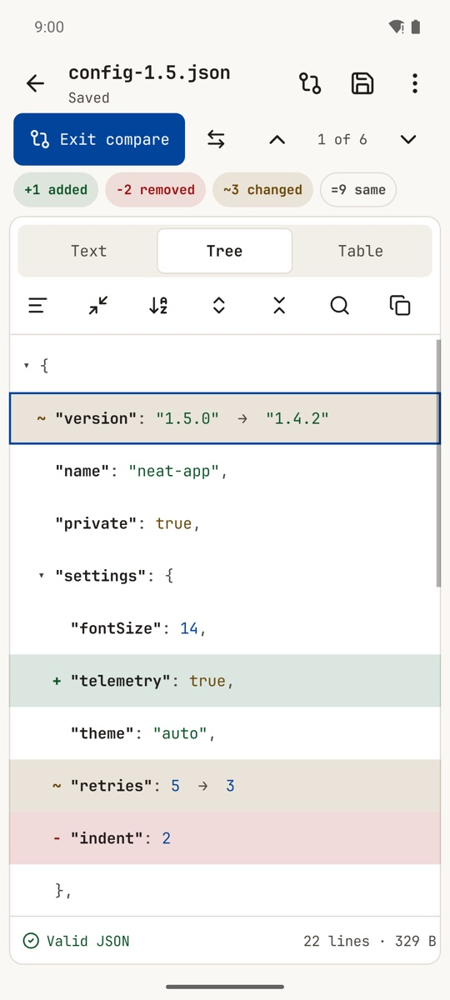

  

<h1 align="center">Neat Nest</h1>

A text editor for Android that turns into a JSON viewer, formatter and compare tool. Free to edit, with Pro for Tree, Table, Compare and themes. No ads, works offline.

  <a href="https://play.google.com/store/apps/details?id=com.zanoshky.neatnest"><b>Google Play</b></a> ·
  <a href="https://neatnest.zanoski.com"><b>neatnest.zanoski.com</b></a> ·
  <a href="https://zanoshky.github.io/neat-nest-app/"><b>User guide</b></a> ·
  <a href="https://github.com/Zanoshky/neat-nest-app/issues/new/choose"><b>Report a bug</b></a>

  

This repo is the public home for Neat Nest users: the user guide, bug reports and feature requests. The app itself is a free Android app with an optional Pro purchase, and its source is not here.

## Quick start

1. Install Neat Nest from Google Play. It runs on Android 7 or newer.
2. Tap Open a file, or tap a .json file in your file manager and pick Neat Nest, then Always.
3. Switch between Text, Tree and Table at the top of the editor.
4. Home, Recent and Settings sit in the bar at the bottom; Settings is a short list with a page for each part.
5. Open More (the three dots at the top right) and tap Compare with another JSON to put a second JSON beside it, or start from the Compare JSON tile on the home screen.

Read the full [user guide](https://zanoshky.github.io/neat-nest-app/guide.html) and the [questions and fixes](https://zanoshky.github.io/neat-nest-app/faq.html).

## Licence

The guide text and images are shared under [CC BY 4.0](LICENSE). The Neat Nest app is proprietary.
